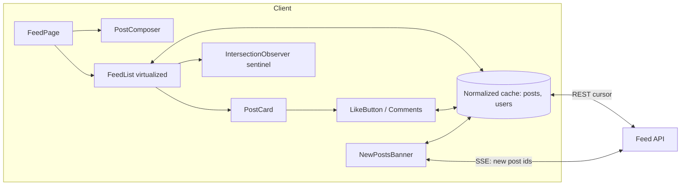
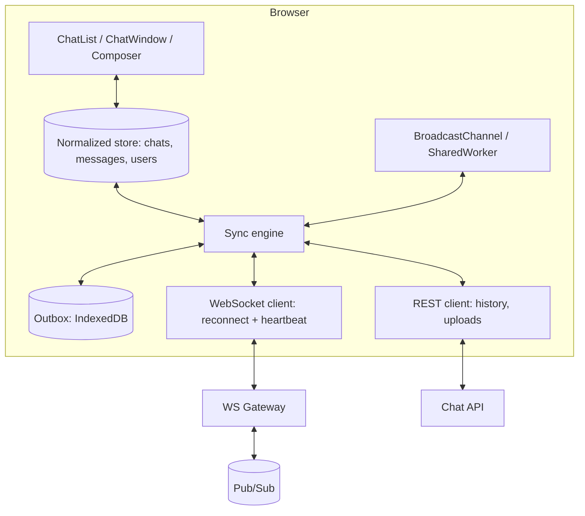

# Фронтенд system design: фреймворк RADIO и 3 кейса

> ⏱ ~6 ч · 🎯 За 45–60 минут провести интервью по проектированию фронтенд-системы: собрать требования, нарисовать архитектуру, модель данных, API компонентов и сервера, обсудить оптимизации и trade-offs.
> ← [Раздел](README.md) · [Роадмап](../ROADMAP.md)

## Чек-лист
- [ ] Прочитал теорию
- [ ] Разобрал примеры кода руками
- [ ] Ответил вслух на вопросы ниже
- [ ] Решил практические задачи
- [ ] Знаю RADIO и тайминг по этапам
- [ ] Прорешал вслух ленту с бесконечным скроллом (45 мин)
- [ ] Прорешал вслух автокомплит (45 мин)
- [ ] Прорешал вслух real-time чат/дашборд (45 мин)
- [ ] Могу сравнить cursor vs offset pagination, WebSocket vs SSE vs polling

## Теория

### Чем фронтенд system design отличается от бэкенд

Не про шардирование БД, а про: архитектуру клиента (компоненты, состояние, потоки данных), контракт с сервером (API, пагинация, real-time), производительность (рендер, сеть, бандл), UX (loading/error/empty, оптимистичные обновления, офлайн), доступность, i18n, безопасность (XSS, CSRF), наблюдаемость.

Интервьюер оценивает: умение задавать вопросы и сужать задачу, структурность, глубину в 1–2 местах по выбору, осознанность trade-offs, коммуникацию. Нет «правильного ответа».

### RADIO (GreatFrontEnd)

| Этап | Что делаем | Время (из 45 мин) |
|---|---|---|
| **R**equirements | Функциональные и нефункциональные требования, скоуп, устройства, масштаб | ~5 мин (<15%) |
| **A**rchitecture | Компоненты высокого уровня и их взаимодействие (диаграмма) | ~5–10 мин |
| **D**ata model | Сущности, где живёт состояние (сервер/клиент, глобальное/локальное), нормализация | ~5 мин |
| **I**nterface (API) | API сервера (эндпоинты, параметры, ответы) и API компонентов (props/events) | ~10 мин |
| **O**ptimizations | Производительность, сеть, UX, a11y, i18n, безопасность, наблюдаемость | ~15 мин (основная глубина) |

Шаблон вопросов на этапе Requirements:
- Основные сценарии? Что вне скоупа?
- Устройства: mobile/desktop, слабые сети, офлайн?
- Масштаб: сколько элементов, частота обновлений, сколько пользователей одновременно?
- SEO/SSR нужен? Первая загрузка критична?
- a11y и i18n (RTL)?
- Real-time требования, консистентность?

💡 На собеседовании: проговаривайте допущения вслух («Предположу, что SEO не нужен — это авторизованная зона, поэтому CSR/SPA»). Записывайте требования списком на доске — к ним удобно возвращаться при обсуждении trade-offs.

### Общие строительные блоки

**Пагинация**:

| | Offset (`?page=3&limit=20`) | Cursor (`?after=abc&limit=20`) |
|---|---|---|
| Прыжок на страницу N | Да | Нет |
| Стабильность при вставках | Дубли/пропуски при новых элементах | Стабильна |
| Производительность БД на больших offset | Падает | Константная |
| Где | Таблицы, админки, поиск с номерами | Ленты, чаты, бесконечный скролл |

**Real-time транспорт**:

| | Short polling | Long polling | SSE | WebSocket |
|---|---|---|---|---|
| Направление | клиент→сервер | сервер→клиент (через ответ) | сервер→клиент | двунаправленный |
| Задержка | интервал | низкая | низкая | низкая |
| Инфраструктура | любая | любая | HTTP, auto-reconnect, `Last-Event-ID` | отдельный протокол, sticky/pub-sub, свой reconnect |
| Когда | редкие обновления, простота | fallback | уведомления, ленты, стриминг (LLM-токены) | чаты, совместное редактирование, игры |

**Рендер**: CSR / SSR / SSG / ISR / streaming SSR / RSC — выбор по SEO, TTFB/LCP, персонализации. **Нормализация**: хранить сущности по id (`Record<id, Entity>` + списки id), чтобы обновление одного объекта отражалось везде.

---

### Кейс 1. Новостная лента с бесконечным скроллом (Facebook/Twitter-like)

**R — требования.** Функциональные: просмотр ленты постов (текст, изображения, видео), бесконечная подгрузка, лайк/комментарий, создание поста, новые посты появляются («N новых постов»). Нефункциональные: быстрый первый показ (LCP), плавный скролл на слабых мобильных, тысячи постов за сессию без деградации памяти, a11y. Вне скоупа: рекомендации, модерация.

**A — архитектура.**



SSR первой страницы (если публичная лента/SEO) или CSR со skeleton; остальное — клиентская подгрузка.

**D — модель данных.**

```ts
type Post = { id: string; authorId: string; text: string; media: Media[]; createdAt: string;
              likeCount: number; likedByMe: boolean; commentCount: number };
type User = { id: string; name: string; avatarUrl: string };
type FeedState = {
  pages: { items: string[]; nextCursor: string | null }[]; // id постов
  pendingNewIds: string[];                                  // пришли по SSE, ещё не показаны
};
// Сущности — нормализованы: posts: Record<string, Post>, users: Record<string, User>
```

Серверный стейт — TanStack Query `useInfiniteQuery`, черновик поста — локальный стейт (+ сохранение в `sessionStorage`).

**I — API.**

```
GET /feed?cursor=<opaque>&limit=20
→ { items: Post[], users: User[], nextCursor: string | null }

POST /posts { text, mediaIds }            → Post
POST /posts/:id/like  | DELETE /posts/:id/like  (идемпотентно)
GET /feed/stream (SSE) → event: new_post, data: { id }
```

Компонент: `<FeedList fetchPage={(cursor) => ...} renderItem={(post) => <PostCard post={post} />} />`.

**O — оптимизации (выбрать 3–4 и углубиться).**
- **Виртуализация** (TanStack Virtual) с динамической высотой: измерение элементов, `overscan`, сохранение позиции при подгрузке сверху. Trade-off: сложности с Ctrl+F, a11y (`aria-setsize`/`aria-posinset`, роль `feed`), якорями.
- **Подгрузка**: `IntersectionObserver` с `rootMargin: '800px'` — префетч до конца; дедупликация параллельных запросов; ретрай с backoff.
- **Новые посты не вставляются в начало автоматически** (прыжок контента) — баннер «Показать 5 новых», вставка по клику.
- **Оптимистичный лайк** с откатом при ошибке; debounce двойного клика.
- **Медиа**: `srcset`/`sizes`, AVIF/WebP, `loading="lazy"` (кроме первого LCP-изображения — `fetchpriority="high"`), резервирование места `aspect-ratio` (CLS), видео автоплей только в viewport и `muted`.
- **Память**: виртуализация + ограничение кэша (`maxPages` в useInfiniteQuery) для очень длинных сессий.
- **Восстановление скролла** при возврате со страницы поста (кэш + сохранённый offset/anchor id).
- **Безопасность**: пользовательский текст — только как текст; rich text — санитайзер (DOMPurify), CSP.
- **Наблюдаемость**: Web Vitals (INP при скролле/лайке), ошибки подгрузки.

```tsx
function Feed() {
  const q = useInfiniteQuery({
    queryKey: ['feed'],
    queryFn: ({ pageParam, signal }) => api.feed(pageParam, signal),
    initialPageParam: null as string | null,
    getNextPageParam: last => last.nextCursor,
    maxPages: 20,
  });
  const sentinel = useRef<HTMLDivElement>(null);
  useEffect(() => {
    const el = sentinel.current;
    if (!el) return;
    const io = new IntersectionObserver(([e]) => {
      if (e.isIntersecting && q.hasNextPage && !q.isFetchingNextPage) q.fetchNextPage();
    }, { rootMargin: '800px' });
    io.observe(el);
    return () => io.disconnect();
  }, [q.hasNextPage, q.isFetchingNextPage, q.fetchNextPage]);
  // ...рендер виртуализированного списка + <div ref={sentinel} />
}
```

---

### Кейс 2. Автокомплит (поиск с подсказками)

**R.** Ввод текста → подсказки с сервера; клавиатурная навигация; выбор подсказки; подсветка совпадения; поддержка мыши/тача; переиспользуемый компонент (разные источники: пользователи, города, товары). Нефункциональные: отзывчивость (ощущается мгновенно), минимум запросов, корректность при гонках, a11y (WAI-ARIA combobox), i18n.

**A.**

```
┌──────────────── Autocomplete (UI) ────────────────┐
│ <input role="combobox"> ──onChange──▶ Controller   │
│ <ul role="listbox"> ◀── state ──────  (hook/VM)    │
└──────────────────────────────┬─────────────────────┘
                               │ debounced query
                     ┌─────────▼─────────┐   miss   ┌──────────┐
                     │  Cache (LRU, TTL) ├─────────▶│ Search   │
                     └─────────▲─────────┘◀─────────┤ API      │
                               └── AbortController ─┘
```

Разделение: headless-хук `useAutocomplete` (состояние, клавиатура, ARIA-пропсы) + презентационный компонент + адаптер источника данных (Strategy).

**D.**

```ts
type Suggestion<T> = { id: string; label: string; data: T };
type AutocompleteState<T> = {
  query: string;
  status: 'idle' | 'loading' | 'success' | 'error';
  items: Suggestion<T>[];
  activeIndex: number;     // -1 — ничего не выбрано
  open: boolean;
};
// Кэш: Map<normalizedQuery, { items, expiresAt }> с LRU-вытеснением
```

**I.**

```
GET /search/suggest?q=mosc&limit=8&locale=ru → { items: [{ id, label, highlight: [[0,4]] }] }
```

```ts
type AutocompleteProps<T> = {
  fetchSuggestions: (q: string, signal: AbortSignal) => Promise<Suggestion<T>[]>;
  onSelect: (item: Suggestion<T>) => void;
  renderItem?: (item: Suggestion<T>, state: { active: boolean }) => React.ReactNode;
  minChars?: number;      // 2
  debounceMs?: number;    // 200–300
  placeholder?: string;
};
```

**O.**
- **Debounce** (а не throttle) ввода; `minChars`; trim/lowercase нормализация ключа кэша.
- **Гонки**: отменять предыдущий запрос `AbortController`; дополнительно игнорировать ответ, если query устарел (сервер может проигнорировать abort).
- **Кэш** на клиенте (LRU + TTL); префикс-кэш: результаты для «mos» можно фильтровать локально для «mosc», пока идёт запрос.
- **Пустой ввод** — недавние/популярные запросы без сети.
- **Сеть**: HTTP-кэш `Cache-Control: max-age` для подсказок, CDN.
- **a11y** (APG combobox pattern): `role="combobox"`, `aria-expanded`, `aria-controls`, `aria-activedescendant` (фокус остаётся в input), `role="option"` + `aria-selected`; клавиши ↑/↓/Enter/Escape/Home/End; live region для «найдено N результатов».
- **IME/композиция** (китайский, японский): не отправлять запросы во время `compositionstart`…`compositionend`.
- **Рендер**: подсветка совпадения без `innerHTML` (разбиение строки на `<mark>`) — защита от XSS; виртуализация не нужна при 8–10 элементах.
- **Мобильные**: `inputmode`, `enterkeyhint="search"`, позиционирование над клавиатурой.

```ts
function useSuggestions<T>(query: string, fetcher: AutocompleteProps<T>['fetchSuggestions'], debounceMs = 250) {
  const [state, setState] = useState<{ status: 'idle' | 'loading' | 'success' | 'error'; items: Suggestion<T>[] }>(
    { status: 'idle', items: [] });
  useEffect(() => {
    const q = query.trim().toLowerCase();
    if (q.length < 2) { setState({ status: 'idle', items: [] }); return; }
    const ctrl = new AbortController();
    const timer = setTimeout(async () => {
      setState(s => ({ ...s, status: 'loading' }));
      try {
        const items = await fetcher(q, ctrl.signal);
        setState({ status: 'success', items });
      } catch (e) {
        if (!ctrl.signal.aborted) setState({ status: 'error', items: [] });
      }
    }, debounceMs);
    return () => { clearTimeout(timer); ctrl.abort(); }; // отмена и таймера, и запроса
  }, [query, fetcher, debounceMs]);
  return state;
}
```

---

### Кейс 3. Real-time чат (с элементами дашборда)

**R.** Список диалогов, окно переписки, отправка текста/вложений, статусы (отправлено/доставлено/прочитано), «печатает…», онлайн-статусы, история с подгрузкой вверх, уведомления в фоне. Нефункциональные: доставка < 1 с, корректная работа при обрывах сети, мультивкладочность, тысячи сообщений в диалоге.

**A.**



Ключевой компонент — **sync engine**: единая точка, которая применяет события из WS и ответы REST к стору, управляет очередью исходящих (outbox) и переподключением.

**D.**

```ts
type Message = {
  id: string;              // серверный id
  clientId: string;        // UUID, сгенерированный на клиенте — для идемпотентности и сопоставления
  chatId: string; authorId: string; text: string;
  createdAt: string;       // серверное время — для сортировки
  seq: number;             // монотонный номер в чате — для детекта пропусков
  status: 'pending' | 'sent' | 'delivered' | 'read' | 'failed';
};
type ChatState = { messageIds: string[]; oldestCursor: string | null; lastSeq: number; unread: number };
```

**I.**

```
WS client→server: { type: 'message.send', clientId, chatId, text }
                  { type: 'typing', chatId }          (throttle 3 с)
                  { type: 'read', chatId, upToSeq }
WS server→client: { type: 'message.ack', clientId, id, seq, createdAt }
                  { type: 'message.new', message }
                  { type: 'presence', userId, online }
REST: GET /chats/:id/messages?before=<cursor>&limit=50
      GET /chats/:id/messages?afterSeq=<n>   — догрузка пропущенного после reconnect
      POST /uploads (presigned URL) → затем message.send с attachmentId
```

**O.**
- **Оптимистичная отправка**: сообщение со статусом `pending` и `clientId` сразу в UI; по `ack` — замена на серверные id/seq; при ошибке — `failed` с кнопкой «повторить». Outbox в IndexedDB переживает перезагрузку.
- **Надёжность**: heartbeat (ping/pong), reconnect с экспоненциальным backoff + jitter; после reconnect — догрузка по `lastSeq` (пропуски детектируются по разрывам `seq`); дедупликация по `id`/`clientId`.
- **Порядок**: сортировать по серверному `seq`/`createdAt`, не по клиентскому времени.
- **Мультивкладочность**: одно WS-соединение на браузер через SharedWorker или leader election + BroadcastChannel; синхронизация прочтений между вкладками.
- **Список сообщений**: виртуализация с обратным направлением (якорь снизу), сохранение позиции при подгрузке истории вверх, «прилипание» к низу только если пользователь был внизу.
- **Typing/presence**: throttle исходящих, TTL на клиенте (если нет события 5 с — скрыть).
- **Фон**: Page Visibility API — снижение активности, Notifications API/Web Push для уведомлений, счётчик в `document.title`.
- **Безопасность**: авторизация WS (токен при handshake/cookie + проверка Origin), санитайзинг контента, ссылки с `rel="noopener noreferrer"`, ограничение размера вложений.
- **Вариант «real-time дашборд»**: обычно SSE достаточно (сервер→клиент); батчинг обновлений (применять раз в `requestAnimationFrame`/250 мс), throttle перерисовки графиков, Canvas/WebGL для тысяч точек, вычисления агрегатов в Web Worker, «живой/пауза» режим, индикатор устаревших данных при обрыве.

```ts
// Reconnect с backoff и jitter
function connect(url: string, onMessage: (data: unknown) => void, attempt = 0): () => void {
  const ws = new WebSocket(url);
  let closedByUser = false;
  ws.onopen = () => { attempt = 0; };
  ws.onmessage = e => onMessage(JSON.parse(e.data));
  ws.onclose = () => {
    if (closedByUser) return;
    const delay = Math.min(30_000, 1000 * 2 ** attempt) * (0.5 + Math.random() / 2);
    setTimeout(() => { if (!closedByUser) cleanup = connect(url, onMessage, attempt + 1); }, delay);
  };
  let cleanup = () => { closedByUser = true; ws.close(); };
  return () => cleanup();
}
```

### Типичные ошибки на интервью

- Сразу рисовать компоненты без вопросов о требованиях.
- Уходить в бэкенд (шардирование, Kafka) — интервьюер ждёт клиент.
- Перечислять оптимизации списком без связи с требованиями и без trade-offs.
- Не упомянуть loading/error/empty-состояния, a11y и обрывы сети.
- Молчать: интервьюеру нужно слышать ход мысли.

## Вопросы с собеседований

<details><summary>Опишите ваш подход к фронтенд system design интервью.</summary>

RADIO: требования (функциональные/нефункциональные, скоуп, допущения) → архитектура (компоненты и потоки данных) → модель данных (что где хранится, нормализация) → интерфейсы (API сервера и компонентов) → оптимизации с trade-offs. Тайм-бокс, вопросы к интервьюеру, глубина в 1–2 местах.
</details>

<details><summary>Cursor или offset pagination для ленты?</summary>

Cursor: стабильна при вставке новых элементов (нет дублей/пропусков), константная стоимость на сервере, курсор непрозрачен. Offset — когда нужен переход на страницу N и общее число (таблицы).
</details>

<details><summary>WebSocket, SSE или polling?</summary>

Polling — редкие обновления и простота. SSE — односторонний поток сервер→клиент по HTTP, автоматический reconnect и `Last-Event-ID`, хорошо для уведомлений и дашбордов. WebSocket — двунаправленный низколатентный обмен (чат, совместное редактирование), но нужно самому делать reconnect, heartbeat, масштабирование.
</details>

<details><summary>Как избежать гонок в автокомплите?</summary>

Отмена предыдущего запроса через AbortController, проверка актуальности query при получении ответа, debounce. В TanStack Query — ключ запроса по query и `signal` в queryFn, кэш по ключу.
</details>

<details><summary>Как сделать виртуализацию списка с динамической высотой?</summary>

Оценочная высота + измерение реальной после рендера (ResizeObserver), пересчёт смещений, overscan. Проблемы: прыжки при изменении высот выше viewport (компенсация scrollTop/якорь), Ctrl+F, a11y. Библиотеки: TanStack Virtual, react-virtuoso. Альтернатива для умеренных размеров — `content-visibility: auto`.
</details>

<details><summary>Как обеспечить доставку сообщений в чате при плохой сети?</summary>

Клиентский id для идемпотентности, outbox в IndexedDB, оптимистичный pending-статус, ack от сервера, ретраи с backoff, догрузка пропущенного по seq после reconnect, дедупликация.
</details>

<details><summary>Как поддерживать одно WS-соединение на несколько вкладок?</summary>

SharedWorker держит соединение и раздаёт события вкладкам через MessagePort; где SharedWorker нет — leader election (Web Locks API `navigator.locks`) + BroadcastChannel: лидер держит соединение и ретранслирует.
</details>

<details><summary>Что обязательно упомянуть в Optimizations, помимо производительности?</summary>

Состояния loading/error/empty/partial, a11y (роли, клавиатура, фокус, live regions), i18n/RTL, безопасность (XSS, CSRF, CSP), офлайн/плохая сеть, наблюдаемость (RUM, Web Vitals, ошибки), тестирование.
</details>

<details><summary>Когда SSR для ленты, а когда CSR?</summary>

SSR/streaming — публичная лента с SEO и важным LCP; персонализированная авторизованная лента — CSR со skeleton или SSR первой страницы при наличии инфраструктуры. RSC позволяют рендерить первую страницу на сервере без гидратации статики. Trade-off: стоимость сервера, TTFB, кэширование персонализированного контента.
</details>

## Практика

**Задача 1.** Спроектируйте (45 мин, вслух) редактор таблиц уровня Google Sheets — только этап Requirements и Architecture.
<details><summary>Решение (ориентиры)</summary>

Требования: размер листа (100k строк × 100 колонок), формулы, совместное редактирование, undo/redo, офлайн? Архитектура: рендер на Canvas (DOM не вытянет), виртуализация по обеим осям, модель ячеек в разреженной структуре (`Map<"r:c", Cell>`), граф зависимостей формул и пересчёт в Web Worker, Command-паттерн для undo/redo, CRDT/OT для коллаборации через WebSocket, overlay-input для редактирования ячейки (a11y через скрытую таблицу/ARIA grid).
</details>

**Задача 2.** Интервьюер: «В ленте 10 000 постов, скролл тормозит на Android». Ваши шаги?
<details><summary>Решение</summary>

Измерить: Performance-профиль на реальном устройстве/CPU throttling, INP/long tasks. Гипотезы: нет виртуализации, тяжёлые PostCard (лишние ререндеры — memo/селекторы), изображения без размеров (layout shift, декодирование — `decoding="async"`, правильные `sizes`), сложные CSS-эффекты (тени, blur), синхронные обработчики scroll (заменить на IntersectionObserver, passive listeners). Внедрить виртуализацию + `maxPages`, проверить метриками.
</details>

**Задача 3.** Спроектируйте компонентный API для автокомплита, который подходит и для городов, и для пользователей с аватарками.
<details><summary>Решение</summary>

Headless-хук `useCombobox({ items, onSelect, itemToString })` возвращает `getInputProps`, `getListProps`, `getItemProps(index)` с ARIA и обработчиками; источник данных — стратегия `fetchSuggestions(q, signal)`; рендер — через `renderItem` или children. Так один хук обслуживает оба случая, представление полностью кастомизируемо (OCP), доступность гарантирована внутри.
</details>

## Источники
- https://www.greatfrontend.com/front-end-system-design-playbook/framework
- https://www.w3.org/WAI/ARIA/apg/patterns/combobox/
- https://tanstack.com/virtual/latest
- https://tanstack.com/query/latest/docs/framework/react/guides/infinite-queries
- https://developer.mozilla.org/en-US/docs/Web/API/Server-sent_events/Using_server-sent_events
- https://developer.mozilla.org/en-US/docs/Web/API/WebSockets_API
- https://developer.mozilla.org/en-US/docs/Web/API/Web_Locks_API
- https://developer.mozilla.org/en-US/docs/Web/API/Intersection_Observer_API
- https://web.dev/articles/vitals
